# DRL-Based District Cooling

Research code for reinforcement-learning-based HVAC and district-cooling optimisation in a Dubai, UAE building model. The project combines EnergyPlus simulation data with an offline energy-transfer-station (ETS) model and Soft Actor-Critic (SAC) and Proximal Policy Optimisation (PPO) controllers.

## Project Overview

The repository is organised as a staged workflow:

1. **EnergyPlus baseline simulation** generates annual building, weather, HVAC, and cooling-coil data at 15-minute intervals.
2. **Dataset preparation** removes design-day records, validates the annual data, converts energy units, adds time features, and writes an RL-ready CSV.
3. **Offline ETS modelling and RL training** uses the EnergyPlus CSV as an exogenous data source. The controllable ETS model maps a chilled-water flow command to delivered cooling, unmet cooling, Delta-T, and pump power. The V3 SAC script and V4 PPO notebook use the same V1/V2 physics and Gymnasium environment for controller comparison.

The current V2/V3/V4 environment is **offline**: actions do not step EnergyPlus interactively and do not modify the baseline zone temperature. Unmet cooling is used as an action-dependent service or comfort proxy.

## Repository Structure

```text
EnergyPlus/
|-- README.md
|-- RL_UAE_HVAC/
|   |-- data/
|   |   |-- raw/eplusout.csv              # Raw EnergyPlus CSV input
|   |   |-- processed/rl_dataset.csv      # Prepared RL dataset
|   |-- docs/packages.txt                  # Initial Python environment notes
|   |-- notebooks/                         # Exploratory notebooks
|   |-- results/phase2/                    # Quality report and validation plots
|   |-- src/
|       |-- data_analysis.py              # Basic CSV inspection
|       |-- prepare_rl_dataset.py         # Dataset preparation and validation
|-- RL_UAE_HVAC_SOFTWARE/
|   |-- eplusout.csv                       # EnergyPlus data used by ETS stages
|   |-- ets_model_v1.py                    # Calibrated ETS physics model
|   |-- ets_gym_v2.py                      # Offline Gymnasium control environment
|   |-- ets_v0_*.csv, ets_v1_*.csv         # ETS validation and baseline results
|   |-- V0_Validation/src/                 # Initial ETS validation
|   |-- V1_controllable offline ETS model/ # Controllable offline physics model
|   |-- V2_offline_gymnasium/              # Gymnasium environment
|   |-- V3_sac_training_stage/src/
|       |-- ets_model_v1.py               # ETS physics model
|       |-- ets_gym_v2.py                 # Offline Gymnasium environment
|       |-- train_sac_v3.py               # SAC training and evaluation
|       |-- v3_sac_output/                 # Models, checkpoints, logs, metrics
|   |-- V4_ppo_training_stage/
|       |-- train_ppo_v4.ipynb            # PPO training, held-out evaluation, benchmarks
|       |-- v4_ppo_output/                 # Models, checkpoints, results, figures, logs
|-- UAE_HVAC/
		|-- models/                            # EnergyPlus IDF input models
		|-- weather/                           # Dubai TMYx weather file
		|-- output/                            # EnergyPlus simulation outputs
		|-- notes/commands.txt                 # EnergyPlus commands and output notes
```

Generated files such as EnergyPlus outputs, model checkpoints, TensorBoard event files, and large CSV datasets may be excluded from a GitHub upload when repository size is a concern.

## Requirements

- macOS, Linux, or Windows
- Python 3.11 recommended
- EnergyPlus 26.1.0 for reproducing the baseline simulation
- Python packages:
  - `numpy`
  - `pandas`
  - `matplotlib`
  - `gymnasium`
  - `stable-baselines3`
  - `torch`
  - `tensorboard`
  - `jupyterlab` (for the V4 PPO notebook)

## Installation

Create the environment with Conda:

```bash
conda create -n rl_energyplus python=3.11 -c conda-forge
conda activate rl_energyplus
python -m pip install numpy pandas matplotlib gymnasium stable-baselines3 torch tensorboard jupyterlab
```

From the repository root, define a shell variable for the project directory:

```bash
export PROJECT_ROOT="$PWD"
```

On Windows, use the equivalent path syntax for your shell instead of `export`.

## Execution Workflow

### 1. Run an EnergyPlus baseline simulation

Update the EnergyPlus executable path if EnergyPlus is installed elsewhere. The following example uses the included 5-zone model and Dubai weather file:

```bash
cd "$PROJECT_ROOT/UAE_HVAC"
/Applications/EnergyPlus-26-1-0/energyplus \
	-w weather/ARE_DU_Dubai.World.Central.Intl.AP-Maktoum.Intl.AP.411945_TMYx.2007-2021.epw \
	-r \
	-d output \
	models/5ZoneAirCooled.idf
```

For the UAE baseline model, replace the final argument with:

```text
models/UAE_Dubai_Baseline.idf
```

The `-r` option requests CSV reporting. Important outputs include:

- `output/eplusout.csv`: tabular simulation data used by Python workflows
- `output/eplusout.err`: EnergyPlus errors and warnings
- `output/eplusout.eso`: raw simulation output
- `output/eplusout.sql`: SQLite results database
- `output/eplusout.rdd` and `output/eplusout.mdd`: available output variables and meters

Copy the generated CSV into the expected raw-data location before preparing the RL dataset:

```bash
cp output/eplusout.csv "$PROJECT_ROOT/RL_UAE_HVAC/data/raw/eplusout.csv"
```

### 2. Inspect and prepare the RL dataset

Run the basic inspection from the `RL_UAE_HVAC` directory:

```bash
cd "$PROJECT_ROOT/RL_UAE_HVAC"
python src/data_analysis.py
```

Prepare the validated dataset:

```bash
python src/prepare_rl_dataset.py
```

This script expects the raw file at `data/raw/eplusout.csv` and produces:

- `data/processed/rl_dataset.csv`
- `results/phase2/data_quality_report.txt`
- validation plots in `results/phase2/`

The script checks the expected EnergyPlus columns, removes design-day data, expects a 15-minute timestep, creates cyclic time features, converts Joules to kWh, and calculates electrical power values.

### 3. Run the ETS model smoke tests

The V1 model and V2 environment can be tested directly with an EnergyPlus CSV:

```bash
cd "$PROJECT_ROOT/RL_UAE_HVAC_SOFTWARE/V3_sac_training_stage/src"
python ets_model_v1.py "$PROJECT_ROOT/RL_UAE_HVAC_SOFTWARE/eplusout.csv"
python ets_gym_v2.py "$PROJECT_ROOT/RL_UAE_HVAC_SOFTWARE/eplusout.csv"
```

The V2 environment has one continuous action in `[0, 1]`, representing the secondary chilled-water flow command. Its reward balances pump power, unmet cooling, low Delta-T behaviour, and action smoothness.

### 4. Train and evaluate the SAC controller

Run a short smoke-test training job:

```bash
cd "$PROJECT_ROOT/RL_UAE_HVAC_SOFTWARE/V3_sac_training_stage/src"
python train_sac_v3.py \
	"$PROJECT_ROOT/RL_UAE_HVAC_SOFTWARE/eplusout.csv" \
	--timesteps 10000
```

Run the standard 100,000-timestep experiment:

```bash
python train_sac_v3.py \
	"$PROJECT_ROOT/RL_UAE_HVAC_SOFTWARE/eplusout.csv" \
	--timesteps 100000
```

Optional training arguments include:

```text
--train-fraction 0.8   Chronological training fraction (default: 0.8)
--seed 42               Random seed (default: 42)
```

The training script aligns the split to complete 24-hour episodes of 96 steps. Results are written to `v3_sac_output/`, including the final model, best model, checkpoints, evaluation logs, `sac_test_results.csv`, and `sac_test_metrics.json`.

#### SAC held-out performance

These V3 figures compare SAC with the EnergyPlus baseline and minimum-feasible benchmark over the held-out period:

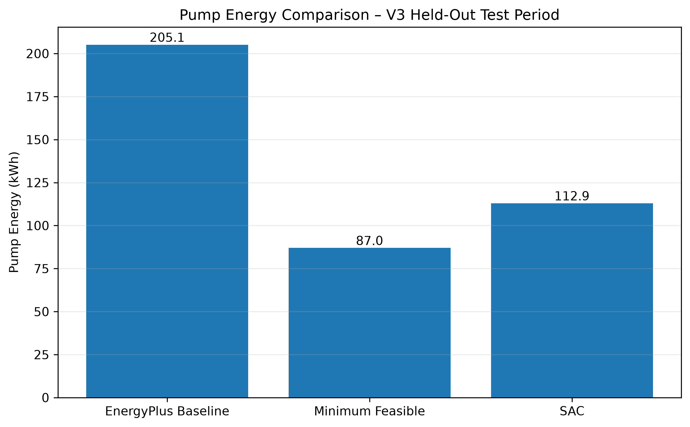

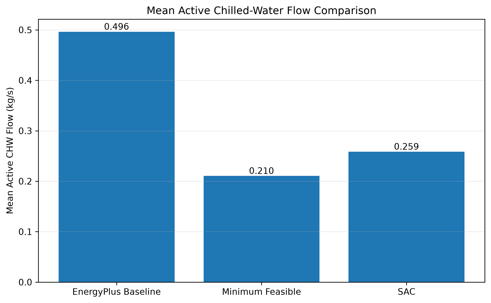

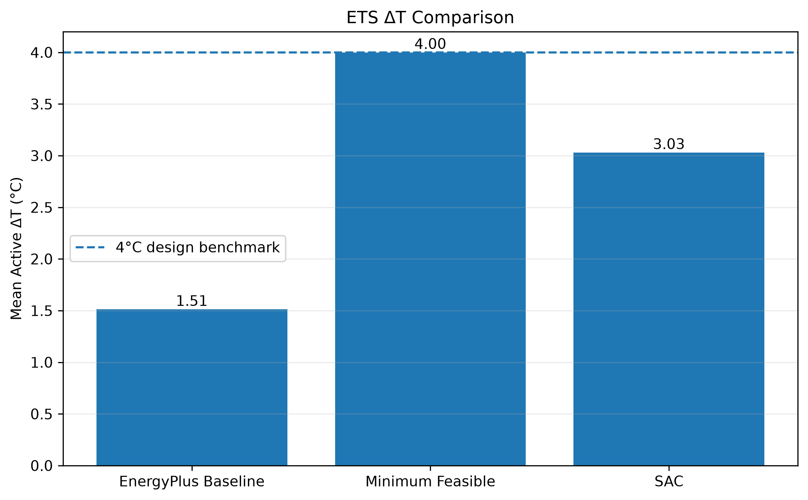

### 5. Train and evaluate the PPO controller (V4)

The V4 workflow is implemented in a Jupyter notebook rather than a standalone training script. It reuses the V1 ETS model and V2 environment, creates a chronological training/held-out split, trains PPO, selects the best checkpoint from evaluations across five held-out periods, and evaluates that policy over the complete held-out trajectory.

The notebook currently sets `PROJECT_ROOT` to a machine-specific path. Update that cell to the absolute path of this repository's `RL_UAE_HVAC_SOFTWARE` directory before running the notebook. The input CSV is `RL_UAE_HVAC_SOFTWARE/eplusout.csv`.

```bash
cd "$PROJECT_ROOT/RL_UAE_HVAC_SOFTWARE/V4_ppo_training_stage"
jupyter lab train_ppo_v4.ipynb
```

Run the notebook cells in order. The recorded experiment uses seed 42, a 100,000-timestep training target, 96-step (24-hour) episodes, and evaluation every 5,000 training steps. Stable-Baselines3 completed 100,352 steps because PPO collects complete rollouts. The selected model was saved from the 10,000-step evaluation.

Results are written under `v4_ppo_output/`:

- `best_model/best_model.zip` and `checkpoints/ppo_v4_*_steps.zip`: selected policy and 10,000-step checkpoints.
- `data/ppo_train.csv` and `data/ppo_test.csv`: chronological training and held-out data.
- `eval_logs/` and `multi_eval_data/`: evaluation history and the five evaluation periods.
- `ppo_test_timeseries.csv` and `ppo_test_metrics.json`: full held-out trajectory and summary metrics.
- `final_results/`: controller benchmark, relative-performance metrics, and experiment summary.
- `figures/` and `tensorboard/`: comparison plots and TensorBoard event logs.

The checked-in benchmark results cover 7,103 held-out 15-minute transitions. PPO delivered 95.60% of required cooling, used 148.05 kWh of pump energy, and had 250.55 kWh_th of unmet cooling. For comparison, SAC delivered 99.96% with 112.94 kWh of pump energy and 2.29 kWh_th unmet; the minimum-feasible controller used 86.97 kWh and delivered 100%. The EnergyPlus baseline pump energy was 205.13 kWh. These are results from the saved experiment outputs, not a guarantee of results from a new training run.

#### PPO and SAC held-out controller performance

The V4 notebook compares the EnergyPlus baseline, minimum-feasible benchmark, SAC, and PPO on the same held-out period. These figures show their pump energy, mean active flow, Delta-T, and cooling delivery:

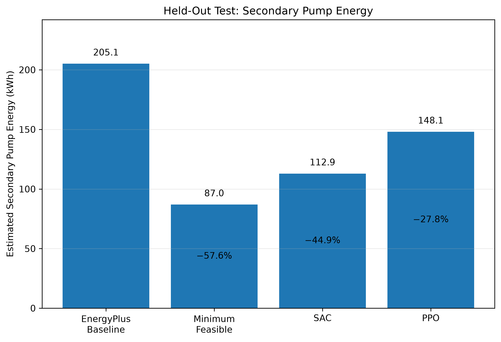

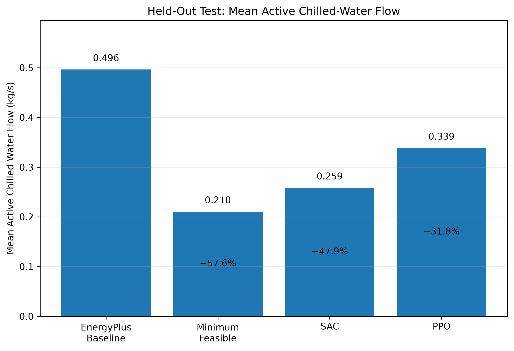

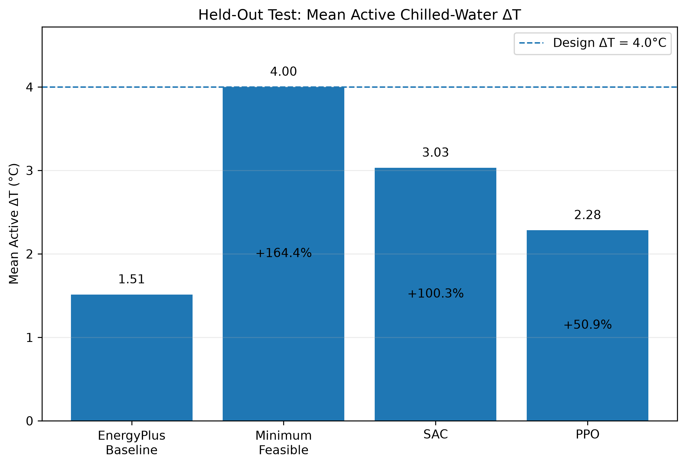

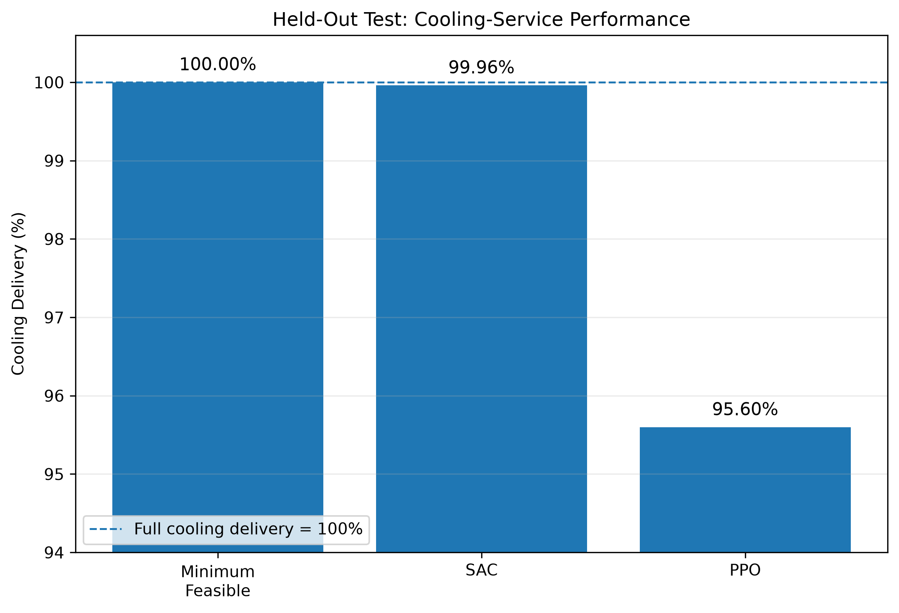

The following V4 plots add context by comparing controller behavior during a representative high-demand day and across cooling-demand bands:

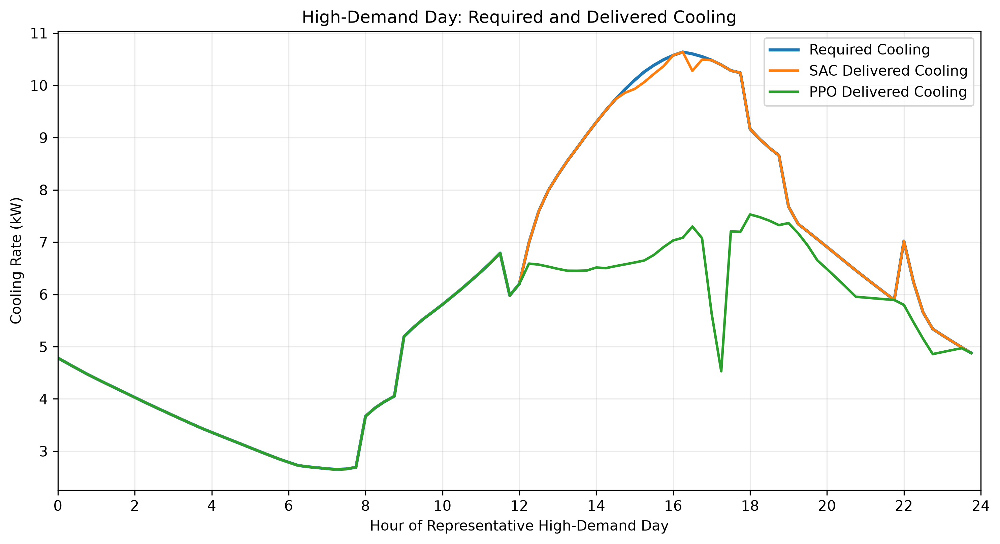

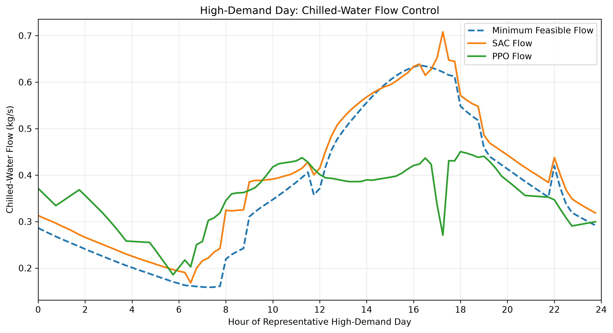

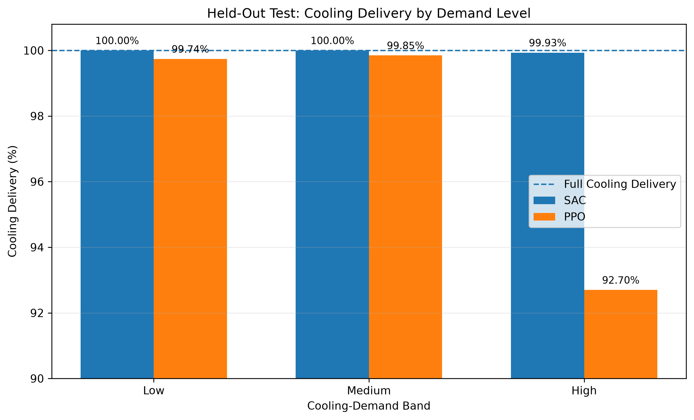

#### Multi-seed SAC/PPO training comparison

The final-evaluation notebook code also compares SAC and PPO evaluation rewards across three seeds (7, 42, and 123). The figures below show the mean reward curves and the individual runs:

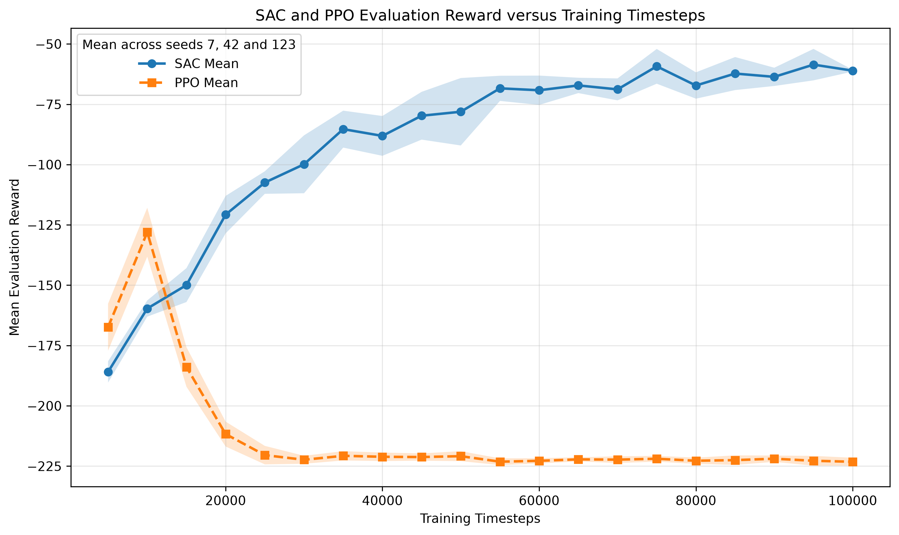

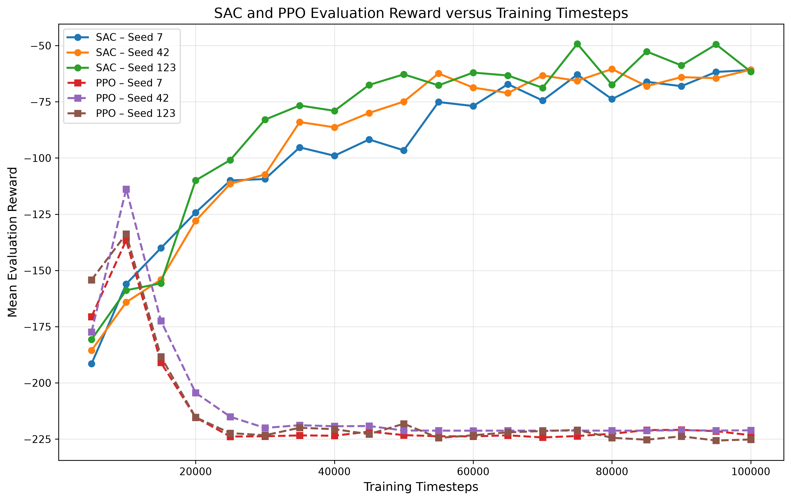

### 6. View TensorBoard logs

For SAC, from the training output directory, run:

```bash
cd "$PROJECT_ROOT/RL_UAE_HVAC_SOFTWARE/V3_sac_training_stage/src/v3_sac_output"
tensorboard --logdir tensorboard
```

For PPO, use:

```bash
cd "$PROJECT_ROOT/RL_UAE_HVAC_SOFTWARE/V4_ppo_training_stage/v4_ppo_output"
tensorboard --logdir tensorboard
```

Open the local URL printed by TensorBoard in a browser.

## Reproducibility Notes

- The supplied EnergyPlus CSV must contain the variables expected by the selected ETS environment.
- The dataset preparation script expects annual 15-minute data: 365 days x 24 hours x 4 steps per hour.
- SAC training uses a chronological train/test split rather than a random row split.
- PPO uses the same offline ETS environment and chronological held-out region as SAC; its notebook records the seed, training settings, and benchmark outputs.
- The current offline environment is suitable for studying the ETS control policy and energy/service trade-off, but it is not a closed-loop EnergyPlus co-simulation.
- Large raw outputs and trained models can make a Git repository difficult to clone. Consider Git LFS or an external artifact store for those files.

## Project Status

The repository contains validated baseline data, an initial and controllable ETS model, an offline Gymnasium environment, and SAC and PPO training/evaluation stages. The checked-in V4 benchmark shows a cooling-delivery versus pump-energy trade-off: PPO reduces pump energy relative to the EnergyPlus baseline but has lower cooling delivery than SAC in this run. Future work can connect the controllers to interactive EnergyPlus simulation and replace the offline service proxy with action-dependent building thermal dynamics.
